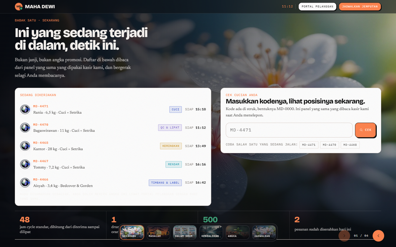
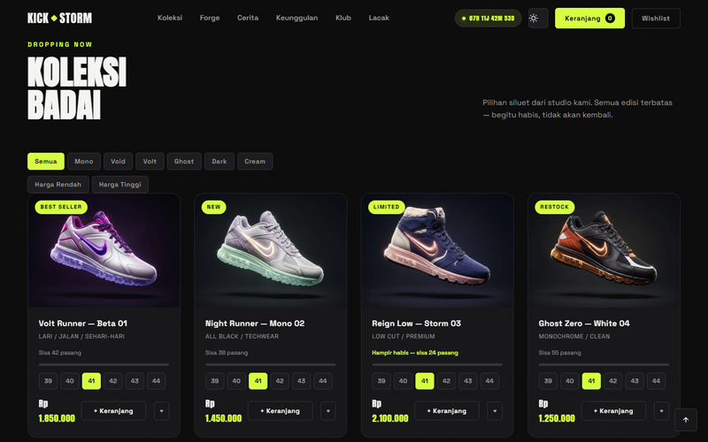
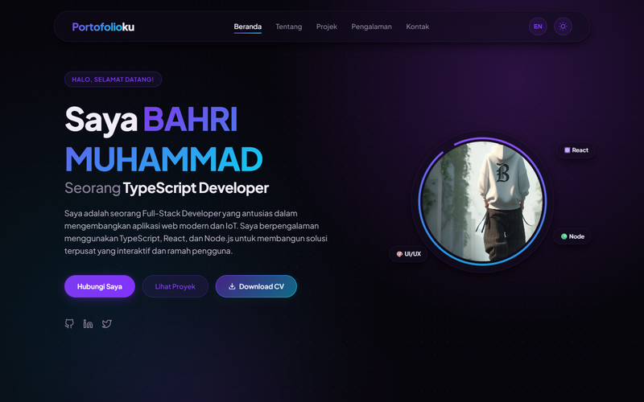
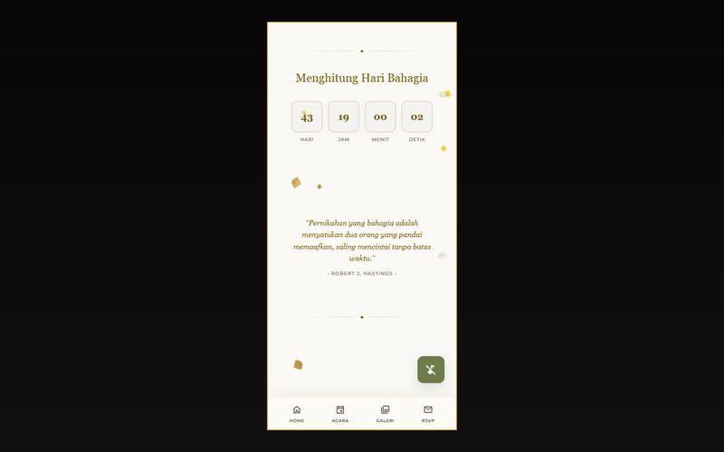

  

  

  
  
  

  

<table>
<tr>
<td width="58%" valign="top">

### ✦ A little about me

I am a full-stack developer in **Mataram, Indonesia**. I build software that a
real business can run on: clear data, safe defaults, tested flows, and
interfaces that work on a phone.

My current focus is **operations software for small businesses** — the kind of
tools that are usually spread across paper, spreadsheets, and chat groups.

- Building **MAHA Dewi Laundry Ops**, a production laundry platform.
- Designing **SymbioTrade**, a B2B marketplace for industrial by-products.
- Writing TypeScript, Fastify, PostgreSQL, React, and plain JavaScript.
- Caring about accessibility, audit trails, and tests that catch regressions.

</td>
<td width="42%" valign="top">
  <blockquote>
    
<strong>Currently</strong>

    
Building <strong>MAHA Dewi Laundry Ops</strong>. 
    Designing <strong>SymbioTrade</strong>. 
    Exploring local-first operations tools. 
    Based in <strong>Mataram, Indonesia</strong>.

  </blockquote>
</td>
</tr>
</table>

  

<h2 align="center">✦ Selected work ✦</h2>

<table>
<tr>
<td width="50%" valign="top">
  
  <h3 align="center">MAHA Dewi Laundry Ops</h3>
  
Fastify · PostgreSQL · WebSocket · vanilla JS

  
A production laundry platform: public storefront, customer portal with
  order tracking and wallet, and a real-time admin dashboard with QRIS
  payments, RBAC, audit logs, and CSV reports.

  
<a href="https://github.com/bahriayet/busa">Source</a> · <a href="https://github.com/bahriayet/busa#screenshots">Screenshots</a>

</td>
<td width="50%" valign="top">
  
  <h3 align="center">KICKSTORM</h3>
  
Express · Neon PostgreSQL · Three.js · GSAP

  
A premium sneaker storefront with a 3D hero, customizer, checkout,
  payment proof, courier tracking, and an admin dashboard for running the
  store.

  
<a href="https://github.com/bahriayet/KICK-STORM">Source</a>

</td>
</tr>
<tr>
<td width="50%" valign="top">
  
  <h3 align="center">Portofolioku</h3>
  
React · Vite · modern CSS

  
A bilingual personal portfolio with dark and light themes, scroll-driven
  motion, project case studies, experience, and a downloadable CV.

  
<a href="https://portofolioku-ochre-nu.vercel.app">Live</a> · <a href="https://github.com/bahriayet/portofolioku">Source</a>

</td>
<td width="50%" valign="top">
  
  <h3 align="center">Undangan Pernikahan</h3>
  
HTML · Tailwind · vanilla JavaScript

  
A mobile-first digital wedding invitation with personalized guest links,
  countdown, music, maps, RSVP via WhatsApp, and a guest book.

  
<a href="https://github.com/bahriayet/undanga-pernikahan">Source</a>

</td>
</tr>
</table>

  

<h2 align="center">✦ Specifications ✦</h2>

  <a href="https://github.com/bahriayet/symbiotrade-spec"><strong>SymbioTrade</strong></a> — a B2B marketplace for industrial by-products. 
  PRD · system requirements · system design · UX flow · sprint plan

  <a href="https://github.com/bahriayet/smart-facility-hub"><strong>Smart Palm-Oil Monitor</strong></a> — mill operations, weighbridge data, local AI yield prediction, truck queues, and Telegram notifications. 
  product requirements · architecture · delivery roadmap

  

<h2 align="center">✦ Tools I reach for ✦</h2>

  

  

<h2 align="center">✦ GitHub in numbers ✦</h2>

  

  
  

  

  Mataram, Indonesia · <a href="mailto:muhammadbahri270899@gmail.com">muhammadbahri270899@gmail.com</a>

  

