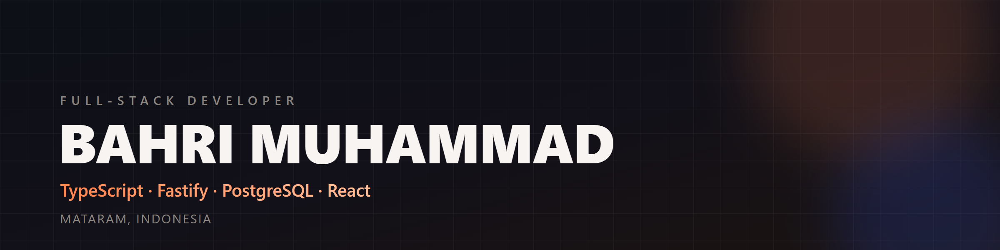

  

<h3 align="center">I build production web apps for small businesses.</h3>

  TypeScript · Fastify · PostgreSQL · React · Next.js

  
  
  

---

## Selected work

### MAHA Dewi Laundry Ops

An operations platform for a real laundry business in Mataram, Indonesia: a six-scene public storefront, a customer portal with order tracking and wallet, and a real-time admin dashboard with stage scanning, QRIS payments, RBAC, audit logs, and CSV reports.

**Stack:** Fastify 5 · PostgreSQL · WebSocket · vanilla JavaScript · Playwright
**Quality:** 67 API/domain tests and end-to-end coverage for the landing page and admin flows.

[Source code](https://github.com/bahriayet/busa) · [Screenshots](https://github.com/bahriayet/busa#screenshots)

### KICK STORM

A premium sneaker brand site with an Express + Neon PostgreSQL backend. Built to practice art direction, motion, and a server-backed product experience.

**Stack:** Express · Neon PostgreSQL · JavaScript · Three.js

[Source code](https://github.com/bahriayet/KICK-STORM)

### Portofolioku

My personal portfolio: a React + Vite site covering projects, experience, and contact details.

**Stack:** React · Vite · modern CSS

[Live site](https://portofolioku-ochre-nu.vercel.app) · [Source code](https://github.com/bahriayet/portofolioku)

---

## Tools I reach for

  
  
  
  
  
  
  
  

## What I care about

- Software that survives contact with a real business: clear data, safe defaults, and boring reliability.
- Tests that catch regressions, not tests that only raise a coverage number.
- Accessibility as part of the interface, not a checklist at the end.
- Small dependencies and code that the next person can read.

---

  Based in Mataram, Indonesia · <a href="mailto:muhammadbahri270899@gmail.com">muhammadbahri270899@gmail.com</a>

